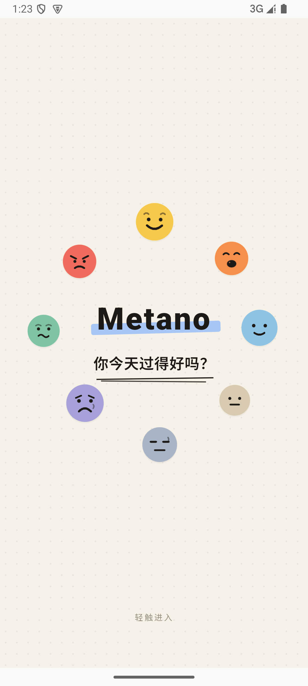
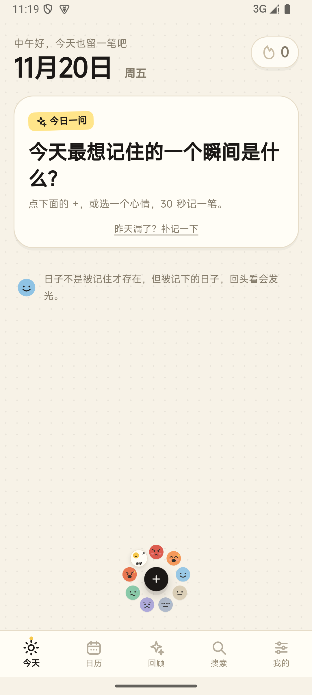
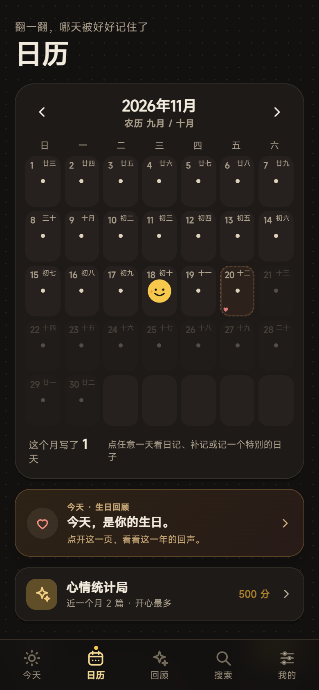
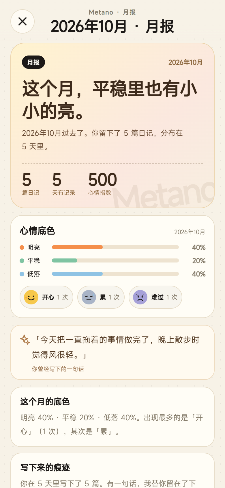

<div align="center">
  
  <h1>Metano · 点点日记</h1>
  <p><strong>每天 30 秒，把日子留成可以翻阅的样子。</strong></p>
  <p>一个本地优先的 Android 心情日记。不打卡、不评分、不催更。</p>
  <p>
    
    
    
    
  </p>
</div>

> Metano 是一个把情绪写下来的地方。它不要求你每天坚持，也不评价你今天过得好不好；只是在你愿意的时候，接住一句话、一张照片、一段声音，然后在月末、年末和特别的日子里，把这些日子轻轻还给你。

## 软件简介

**Metano** 是一个运行在 Android 上的本地日记 App，名字来自古希腊语 **metanoia（μετάνοια）**：`μετά`（改变、转向）+ `νοέω`（思考、感知、觉察），意思是“重新思考，认知发生转变”。末尾的 `-ia` 被收起来，留下 **Metano**，读作 `/məˈtɑːnəʊ/`。

它想做的不是“效率工具”，也不是“情绪打分器”，而是一个可以放心放下的角落：

- **写下来**：文字、50 个心情表情、照片、语音、城市/区级地点，一天一篇，也可以补记；
- **翻回去**：日历里能看到每天的心情、农历、计划打卡和生日/纪念日/特别日子；
- **被接住**：月末有月报，年末有年报，生日和特别的日子有专属回顾；不评判、不比较、不催你振作；
- **只属于你**：没有账号、没有云同步、不接大模型；日记、照片、语音、计划和日历事件都留在手机本地，备份由你自己导出和保管。

### 界面示意

> 以下截图使用合成演示数据，不是任何人的真实日记。

| 封面 | 今天 |
| --- | --- |
|  |  |

| 日历里的特别日子 | 月报 |
| --- | --- |
|  |  |

## 它能做什么

### 1. 每天记一笔

- 一天一篇，可以修改，也可以补写过去的日子；
- 50 个心情表情，首页转盘可自定义 8 个常用心情；
- 写日记页可以单独管理自己的两排表情，不会反过来改首页转盘；
- 写完文字后，本机用轻量情绪词规则给出一个心情建议，你可以随时改；
- 每篇最多 6 张照片，自动压缩后存本机；
- 每篇一段最长 3 分钟的语音，原声保存，不转文字；
- 可记录城市/区级别的“在哪里”，也可以手动改成“家 / 学校 / 公司”；
- 每天第一次打开时，会有一张手绘插画和一句轻轻的话，一共 21 组，按日期轮换。

### 2. 日历与特别的日子

- 月历显示每天的心情圆脸、农历和计划打卡小圆点；
- 点任意一天先看“这一天”的详情：星期、农历、日记摘要、照片数、语音时长和地点；
- 没有日记的日子可以补记；未来的日子也可以先放一个生日、纪念日或特别的日子；
- 生日、纪念日、特别的日子支持新历/农历、每年重复和本地提醒；
- 生日默认前一天 09:00 和当天 09:00 各提醒一次；纪念日和特别日子默认当天提醒，可单独关闭。

### 3. 计划

- 在日历页下方管理计划：每天做到 / 每周做到 / 自定义每隔几天做到一次；
- 内置看书、健身、早睡早起、控制饮食、减脂、跑步、自律等模板，也可以自定义标签；
- 看书计划可以记页数、看进度和预计读完时间；
- 每个计划可以选颜色、设本地通知，打卡记录和近 7 天圆点会留在日历里。

### 4. 回顾、统计与报告

- **回顾页**：本周篇数、最常出现的心情、往年今日、随机翻开一页、分类分布、关键词和心情分布；
- **心情统计局**：心情指数、明亮/平稳/低落比例、心情 Top 10，可切换一个月 / 三个月 / 一年 / 全部；
- **月报**：月份结束后，为有日记的月份生成一页回顾：篇数、记录天数、心情比例、Top 3 心情、一句原话、写给你的话和“下个月一件小事”；
- **年报**：年份结束后生成，多一张 12 个月记录篇数的柱状图，能看到哪几个月写得多、哪几个月比较安静；
- **特别的日子回顾**：生日、纪念日、自定义特别日当天生成，包含过去一年的心情回声、Top 3 心情、一句原话和今天可以做的一件小事；
- 报告只在本机生成和保存，是一张“已经收好的纸”；之后修改旧日记，不会把旧报告反复改写。

### 5. 搜索与偏好

- 即时搜索，自带近义词（例如“难过”也会命中“伤心”“低落”“emo”）；
- 可以按心情、分类和日期范围筛选，多个条件可以叠加；
- 深色 / 浅色 / 跟随系统三种主题；
- 11 种字体选择、85%–120% 字号、日记正文左/中/右对齐；
- 可以整理表情仓库、设置首页转盘、开关音效、设置 4 位 App 密码；
- 支持 JSON 备份导出与导入；清空数据前会二次确认。

### 6. 隐私与边界

- 没有账号系统，没有云端同步，没有分析统计 SDK；
- 日记、照片、语音、地点、计划、日历事件都保存在本机 App 私有空间（WebView IndexedDB，数据库 `diandian-diary`）；
- 定位只保存城市/区级别，不记录门牌；
- 密码是 App 内的“软锁”，忘记可以在锁屏页重置，不会删除日记；
- 备份文件由用户自己保存和分享，App 不会自动上传。

## 技术栈

| 层 | 使用 |
| --- | --- |
| 前端 | React 18 + TypeScript + Vite 5 |
| 本地数据 | Dexie + IndexedDB |
| Android 容器 | Capacitor 8 |
| 原生能力 | Local Notifications、Filesystem、Share、Geolocation |
| 农历 | `lunar-javascript` |
| 测试 | Playwright（Web 端交互与截图验收） |

## 项目结构

```text
src/
  pages/         今天、日历、回顾、搜索、我的
  components/    心情转盘、编辑器、日历详情、计划板、报告页等
  lib/           数据库、日期/农历、心情统计、报告生成、备份、原生桥接
  assets/        字体与本地视觉资源
public/          图标、每日插画
android/         Capacitor Android 工程
docs/            README 截图
```

## 本地运行

需要 Node.js 18+。

```bash
npm install
npm run dev
```

打开终端提示的地址（默认 `http://localhost:5173`）。

### 构建 Web 版本

```bash
npm run build
```

构建产物在 `dist/`。

### 构建 Android Debug APK

需要 JDK 21、Android SDK（compileSdk 36）和可用的 Android 构建环境。

```bash
npm run build
npx cap sync android

cd android
# Windows
.\gradlew.bat assembleDebug
# macOS / Linux
./gradlew assembleDebug
```

APK 输出在 `android/app/build/outputs/apk/debug/app-debug.apk`。

首次构建前，请在本机创建 `android/local.properties`，指向自己的 Android SDK：

```properties
sdk.dir=/path/to/your/android-sdk
```

`local.properties`、构建产物、APK、`node_modules` 和原始字体文件都不进入 Git 仓库。

## 当前版本

- 版本：`0.7.0`（versionCode `24`）
- 包名：`com.diandian.diary`
- 最低 Android：`minSdk 24`
- 目标 Android：`targetSdk 36`
- Release 附件提供的是 **debug 签名** APK，仅用于体验和测试，不适合正式上架或对外分发。

## 已知限制

- 目前只在 Web 端做了较完整的交互与深色/浅色截图验收；Android 真机上的视觉和通知行为仍建议安装后逐项确认。
- 没有云同步、没有多设备自动合并；换机请使用 JSON 备份导入。
- 目前没有 iOS 工程。
- 报告是生成时的快照，不会因为后来补写或修改旧日记而自动重算。
- 农历生日遇到小月没有三十时按当月最后一天处理；暂不支持闰月选择。

## 名字与态度

Metano 不把情绪变成 KPI，也不把“坚持”变成负担。

今天写一句也好，隔几天再回来也好。你不需要每天都很好，日子也不需要每一天都被记住。

> 记录 · 复盘 · 更新自己

## License

本仓库目前用于作品展示与源码备份，**未附加开源许可证**。代码可以查看和学习；如需复用、分发或商用，请先联系作者获得许可。

字体、插画和第三方依赖遵循各自的原始授权，不在本仓库的代码许可范围内。
